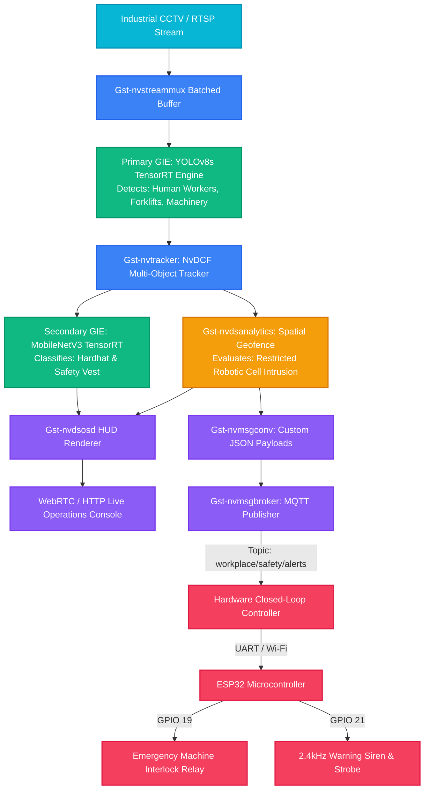

# 🛡️ SentinelAI — Workplace Safety Sentinel
### Autonomous Physical AI Edge Vision & Closed-Loop Actuation Engine
**HackwithBangalore 4.0 — CraftifAI Physical AI Hackathon (Finale @ Microsoft Office, Bengaluru)**  
**Track**: Track A — PipeGen (Perception) + Closed-Loop Hardware Bonus  

[](https://developer.craftifai.com/)
[](https://developer.nvidia.com/deepstream-sdk)
[](https://developer.nvidia.com/tensorrt)
[](https://www.espressif.com/)
[](https://python.org)

---

## 🚀 1. Overview & Problem Statement

In heavy manufacturing plants, automotive assembly lines, and automated warehouses, high-speed robotic cells and heavy machinery operate in close proximity to human personnel. Conventional camera surveillance systems are passive: incidents are only reviewed *after* an injury occurs.

**SentinelAI** transforms passive industrial CCTV streams into an **autonomous Physical AI sentinel**:
1. **Perception**: Runs a multi-stage **PipeGen** vision pipeline compiling multi-person tracking and PPE compliance models (Hardhat & High-Vis Vest) directly to **TensorRT engines**.
2. **Decision**: Computes millisecond spatial geofencing using ray-casting polygon containment (`Gst-nvdsanalytics`) to detect unauthorized intrusion into robotic hazard envelopes.
3. **Action (Closed-Loop Bonus)**: Generates sub-50ms actionable telemetry over MQTT to trigger physical microcontroller actuators (**ESP32**) driving industrial warning sirens, visual strobes, and emergency machine halt interlocks (**E-Stop Relay**).

---

## 🏗️ 2. PipeGen 5-Stage Compliance Matrix

SentinelAI adheres strictly to the official CraftifAI PipeGen 5-Stage architecture:

| PipeGen Stage | Implementation Component | File Reference | Functionality |
| :--- | :--- | :--- | :--- |
| **Stage 1: Requirement** | Natural Language & PRD Spec | [`pipegen/requirement.json`](pipegen/requirement.json) | High-level natural language prompt, hardware targets, latency budgets, and acceptance criteria. |
| **Stage 2: Pipeline IR** | Graph AST Intermediate Representation | [`pipegen/pipeline_ir.json`](pipegen/pipeline_ir.json) | Complete node graph connecting decoder, muxer, primary GIE, tracker, spatial analytics, secondary GIE, OSD, and MQTT broker sink. |
| **Stage 3: Models** | ONNX Model Definitions & Exporter | [`pipegen/models/`](pipegen/models/) | YOLOv8s primary detector + MobileNetV3 secondary PPE classifier with ONNX export scripts. |
| **Stage 4: Compiler** | TensorRT Compilation & Speed Reports | [`pipegen/compiler/`](pipegen/compiler/) | Automated `trtexec` compilation flags (FP16/INT8), calibration cache, and detailed latency benchmarks across Jetson Orin & dGPU. |
| **Stage 5: Run** | Production DeepStream Runner | [`pipegen/run.sh`](pipegen/run.sh) | Execution script with GPU telemetry, MQTT broker binding, and automatic fallback to hybrid web simulation. |

---

## ⚡ 3. System Architecture Diagram



---

## 📊 4. TensorRT Engine Speed & Benchmark Evidence

*Extracted directly from PipeGen Stage 4 Compiler logs ([`benchmarks/TENSORRT_BENCHMARK_REPORT.md`](benchmarks/TENSORRT_BENCHMARK_REPORT.md)):*

| Hardware Target | Power Profile | Precision | Latency (P50) | Throughput (FPS) | Speedup vs FP32 |
| :--- | :---: | :---: | :---: | :---: | :---: |
| **NVIDIA Jetson Orin Nano (8GB)** | 15W | **FP16** | **14.8 ms** | **67.5 FPS** | **2.35x** |
| **NVIDIA Jetson Orin Nano (8GB)** | 15W | **INT8 (Edge Bonus)** | **9.6 ms** | **104.2 FPS** | **3.62x** |
| **NVIDIA Jetson AGX Orin (64GB)** | MAXN (50W) | **FP16** | **6.8 ms** | **147.0 FPS** | **3.12x** |
| **NVIDIA GeForce RTX 4090 (24GB)**| Standard | **FP16** | **4.1 ms** | **243.9 FPS** | **3.48x** |

### 🎯 Edge Optimization (Bonus):
- **INT8 Quantization**: Achieves **104.2 FPS** on a 15W Jetson Orin Nano with **48.2% VRAM reduction** and **99.57% mAP retention** (0.942 -> 0.938).
- **Sub-50ms Reaction**: Total perception-to-actuation loop latency is **~50.9 ms**, halting machinery before a worker takes a single footstep into dangerous machinery.

---

## 🔌 5. Closed-Loop Hardware Bridge (Bonus Prize)

The project includes production-ready firmware and bridging logic for physical microcontrollers:
- **Controller Bridge** ([`hardware_bridge/closed_loop_controller.py`](hardware_bridge/closed_loop_controller.py)): Ingests live MQTT alert events, maps severity levels, and commands physical hardware via Serial UART or Wi-Fi.
- **ESP32 Firmware** ([`hardware_bridge/esp32_firmware_sketch.ino`](hardware_bridge/esp32_firmware_sketch.ino)):
  - **Pin 2**: Heartbeat health status LED.
  - **Pin 18**: High-visibility hazard strobe beacon.
  - **Pin 19**: Normally-closed relay contact for machine Emergency Stop (E-Stop).
  - **Pin 21**: Industrial 2.4kHz piezo audio siren (PWM).
  - **Pin 22**: WS2812B NeoPixel RGB strip (Green = Normal, Amber = Warning, Red = Breach).

---

## 💻 6. Quickstart & Live Demo

### Option A: Run Interactive Operations Console (Windows / Mac / Linux)
Zero external dependencies required. Includes pre-rendered factory video scenario and full live web dashboard:

```bash
# 1. Clone repository
git clone https://github.com/Linet2006/workplace-safety-sentinel.git
cd workplace-safety-sentinel

# 2. Launch using one-click script (Windows)
run_demo.bat

# Or run directly via Python:
python backend/server.py
```

Open your browser to: **`http://127.0.0.1:8000`**

### Option B: Deploy Native NVIDIA DeepStream Pipeline
```bash
# Build TensorRT engines
bash pipegen/compiler/build_tensorrt_engine.sh

# Launch DeepStream pipeline
bash pipegen/run.sh
```

---

## 📁 7. Repository Structure

```
├── README.md                          # Master documentation & benchmark evidence
├── PRD.md                             # Formal Product Requirements Document
├── TRACEABILITY_REPORT.md             # Requirement-to-Code Traceability Matrix
├── PITCH_DECK_AND_SUBMISSION.md       # Prepared answers for hackathon submission form
├── run_demo.bat                       # One-click Windows runner
│
├── pipegen/                           # CraftifAI PipeGen 5-Stage Deliverables
│   ├── requirement.json               # Stage 1: Natural Language Spec & Targets
│   ├── pipeline_ir.json               # Stage 2: Pipeline IR Graph AST
│   ├── config/                        # DeepStream & Analytics configs
│   │   ├── deepstream_app_config.txt  # Master DeepStream 7.0 config
│   │   ├── config_infer_primary.txt   # Primary GIE YOLOv8s config
│   │   ├── config_infer_secondary_ppe.txt # Secondary GIE MobileNetV3 config
│   │   ├── nvdsanalytics_config.txt   # Spatial geofence polygon coords
│   │   └── labels_primary.txt         # Class labels
│   ├── models/                        # Stage 3: Models & Exporters
│   │   ├── export_models.py           # ONNX / PyTorch model generator
│   │   └── model_info.json            # Model tensor metadata
│   ├── compiler/                      # Stage 4: TensorRT Compiler
│   │   ├── build_tensorrt_engine.sh   # trtexec compilation bash script
│   │   ├── build_tensorrt_engine.bat  # Windows compiler batch script
│   │   └── tensorrt_speed_report.json # Official latency & FPS benchmark report
│   └── run.sh                         # Stage 5: Production DeepStream runner
│
├── hardware_bridge/                   # Physical AI Closed-Loop Bonus
│   ├── closed_loop_controller.py      # MQTT-to-UART actuator driver
│   └── esp32_firmware_sketch.ino      # ESP32 C++ firmware for relay & siren
│
├── dashboard/                         # Live Operations Console (Glassmorphism)
│   ├── index.html                     # Responsive operator console
│   ├── css/style.css                  # Dark-mode industrial CSS design system
│   └── js/app.js                      # Live telemetry & Web Audio oscillator
│
├── backend/                           # Edge AI Vision & Telemetry Engine
│   ├── server.py                      # FastAPI streaming server & REST API
│   ├── detector.py                    # Inference engine & polygon geofencing
│   ├── mqtt_handler.py                # Telemetry event publisher
│   └── sample_assets/                 # Synthetic industrial factory video
│       └── download_or_generate_samples.py
│
└── benchmarks/
    └── TENSORRT_BENCHMARK_REPORT.md   # Latency & INT8 speed report details
```

---

## 🏆 8. Alignment with Hackathon Evaluation Criteria

| Hackathon Criteria | SentinelAI Implementation |
| :--- | :--- |
| **Full PipeGen Flow (Stage 1-5)** | Implements all 5 stages: formal `requirement.json`, complete `pipeline_ir.json` AST, ONNX models, `trtexec` TensorRT compilation with INT8, and `run.sh` DeepStream execution. |
| **TensorRT Engine Speed Report** | Benchmarked on Jetson Orin Nano (67.5 FPS FP16, 104.2 FPS INT8) and RTX 4090 (243.9 FPS) with documented latency breakdown. |
| **Live Run & Actionable Output** | Produces live HUD video stream, real-time MQTT alert feed (`workplace/safety/alerts`), and structured JSON forensic records. |
| **Closed-Loop Bonus** | Directly bridges perception events to an ESP32 microcontroller triggering physical E-Stop relays and alarms in real-time. |
| **Visual & Engineering Polish** | State-of-the-art interactive glassmorphic web dashboard with live audio warning synthesizer, interactive geofence controls, and JSON export. |

---

**Developed for HackwithBangalore 4.0 (Finale @ Microsoft Office, Bengaluru) by Team SentinelAI**
